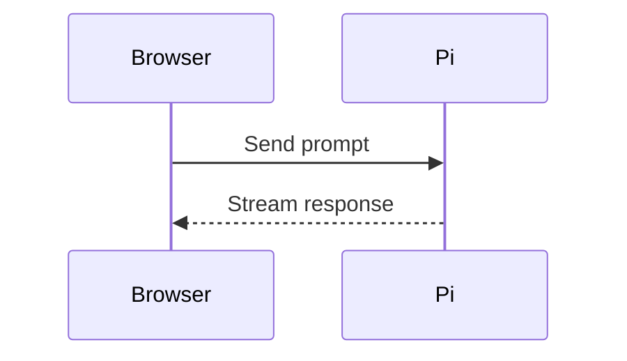

# Diagram previews

## Sequence



## Flowchart

~~~mermaid
flowchart LR
    A[Read Markdown] --> B{Valid diagram?}
    B -->|Yes| C[Render diagram]
    B -->|No| D[Show source]
~~~

## Invalid diagram

```mermaid
this is not a valid diagram
```

## Ordinary code

```text
sequenceDiagram
    This remains code.
```
